# Домашнее задание к занятию 11 «Teamcity»

## Ссылка на репозиторий с выполненным заданием
*Основной репозиторий с кодом (форк):* [https://github.com/akamsoft/example-teamcity](https://github.com/akamsoft/example-teamcity)

## Выполнение задания

### Подготовка к выполнению

**1. В Yandex Cloud создайте новый инстанс (4CPU4RAM) на основе образа `jetbrains/teamcity-server`. Дождитесь запуска teamcity, выполните первоначальную настройку.**
*   Инстанс `teamcity-01` создан с конфигурацией 4 vCPU, 4 GB RAM на базе образа `jetbrains/teamcity-server`. Первоначальная настройка (выбор БД, создание администратора) выполнена.

**2. Создайте ещё один инстанс (2CPU4RAM) на основе образа `jetbrains/teamcity-agent`. Пропишите к нему переменную окружения `SERVER_URL: "http://<teamcity_url>:8111"`. Авторизуйте агент.**
*   Инстанс `teamcity-02` создан с конфигурацией 2 vCPU, 4 GB RAM. В переменные окружения контейнера добавлена строка `SERVER_URL=http://84.201.130.159:8111` (строго без кавычек). Агент успешно авторизован в веб-интерфейсе TeamCity.

**3. Сделайте fork репозитория.**
*   Создан форк репозитория `aragastmatb/example-teamcity` в аккаунт `akamsoft`.

**4. Создайте VM (2CPU4RAM) и запустите playbook.**
*   Создана ВМ `nexus-01` (2 vCPU, 4 GB RAM). Установка Nexus 3.14 выполнена через Ansible playbook. В процессе установки playbook был адаптирован под ОС Ubuntu (заменен пакет JDK и добавлена установка `acl`). Nexus успешно запущен как служба systemd.

*Скриншоты виртуальных машин Yandex Cloud:*

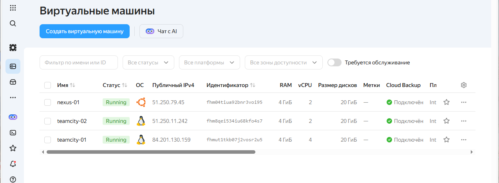

*Скриншоты установки Nexus через Ansible playbook*

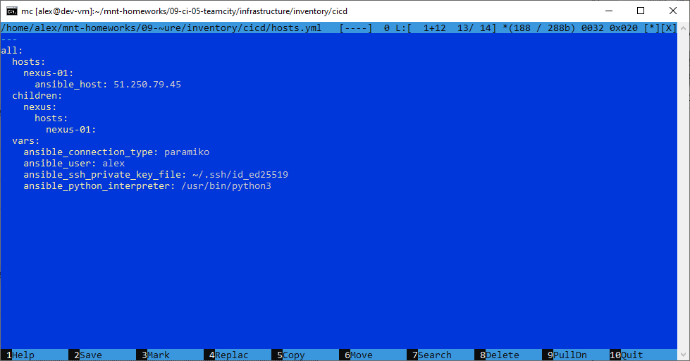

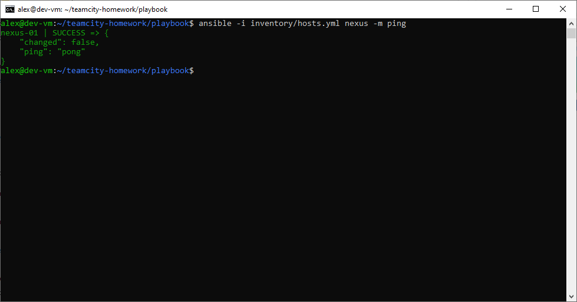

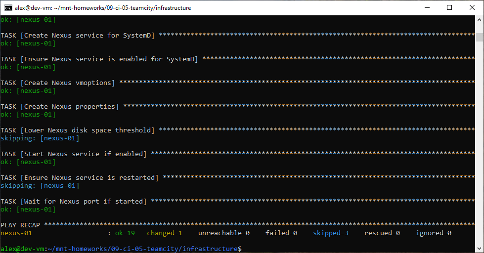

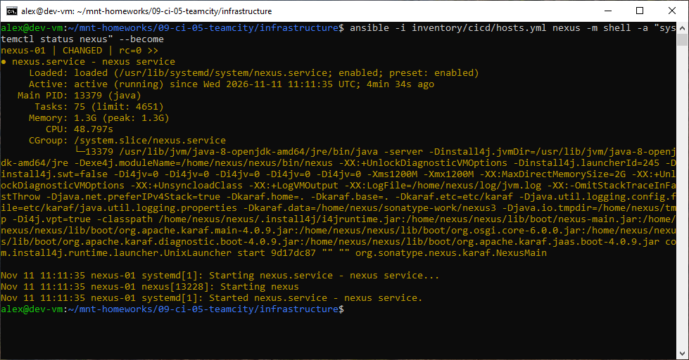

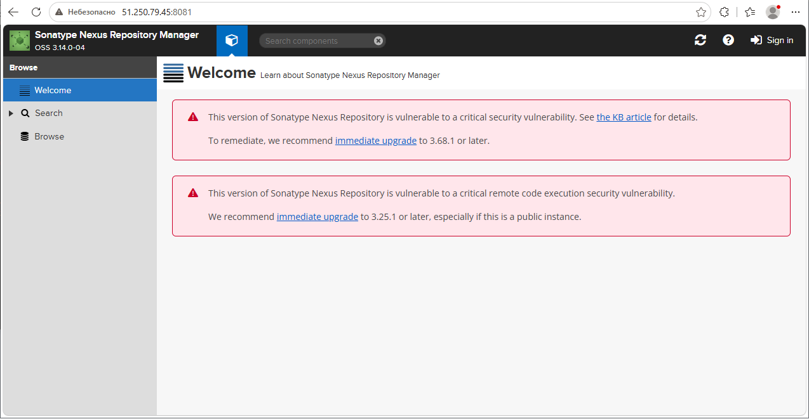

---

### Основная часть

**1. Создайте новый проект в teamcity на основе fork. Сделайте autodetect конфигурации. Сохраните необходимые шаги, запустите первую сборку master.**
*   Проект `Example Teamcity` создан на основе URL форка. Автодетект успешно обнаружил `pom.xml` и сгенерировал шаги сборки. Первая сборка `master` прошла успешно (Tests passed: 5).

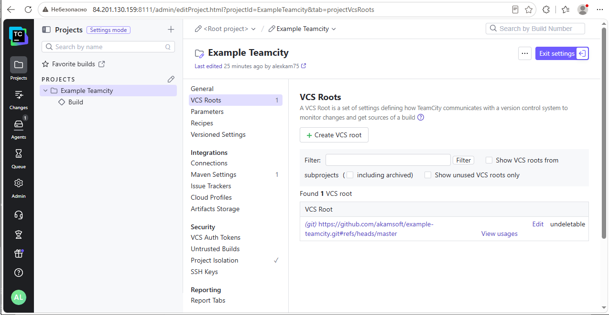

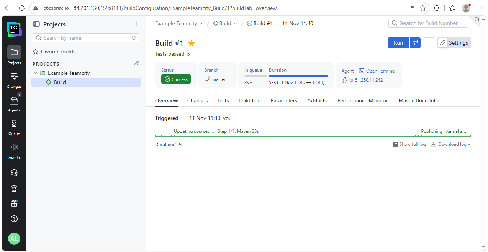

**2. Поменяйте условия сборки: если сборка по ветке `master`, то должен происходит `mvn clean deploy`, иначе `mvn clean test`.**
*   В настройках `Build Steps` настроены два шага Maven:
    *   Шаг 1: `clean test`. Условие выполнения (Execution conditions): `teamcity.build.branch does not match master`.
    *   Шаг 2: `clean deploy`. Условие выполнения: `teamcity.build.branch matches master`.

*Скриншоты настроек сборки:*

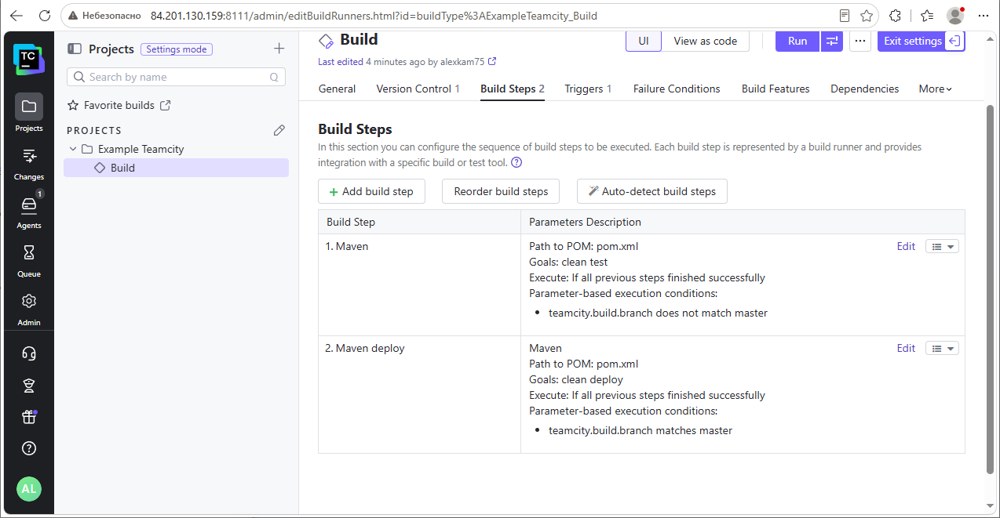

**3. Для deploy будет необходимо загрузить `settings.xml` в набор конфигураций maven у teamcity, предварительно записав туда креды для подключения к nexus.**
*   Файл `settings.xml` с логином и паролем администратора Nexus загружен в раздел `Maven Settings` проекта под именем `nexus-settings`. В шаге сборки `clean deploy` выбрано использование этих настроек.

*Скриншот загруженного settings.xml:*

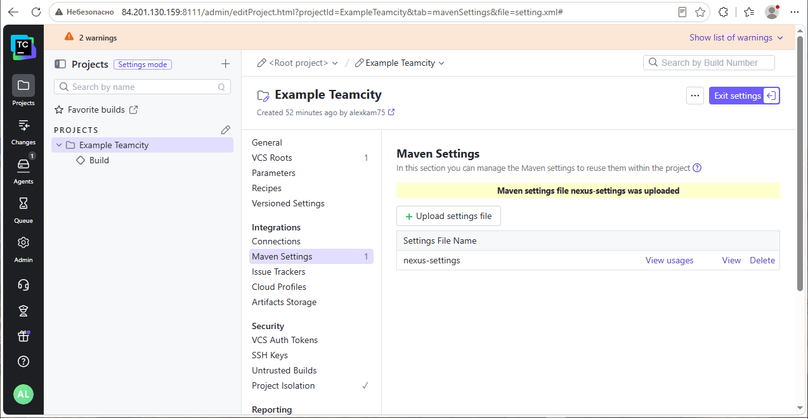

**4. В `pom.xml` необходимо поменять ссылки на репозиторий и nexus.**
*   В `pom.xml` добавлена секция `<distributionManagement>` с указанием URL созданного в Nexus репозитория `maven-releases` (`http://51.250.79.45:8081/repository/maven-releases/`). ID репозитория (`nexus`) совпадает с ID в `settings.xml`.

**5. Запустите сборку по master, убедитесь, что всё прошло успешно и артефакт появился в nexus.**
*   Сборка по `master` прошла успешно. В Nexus (репозиторий `maven-releases`, путь `org/netology/plaindoll/0.0.2/`) появились файлы `.jar` и `.pom`.

*Скриншоты артефакта в Nexus и успешной сборки:*

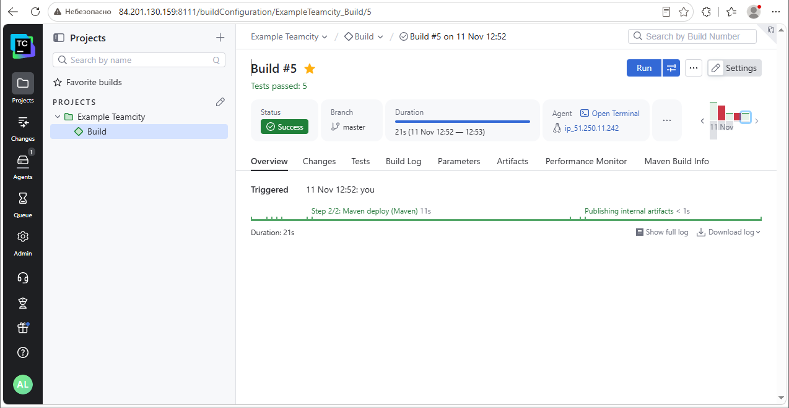

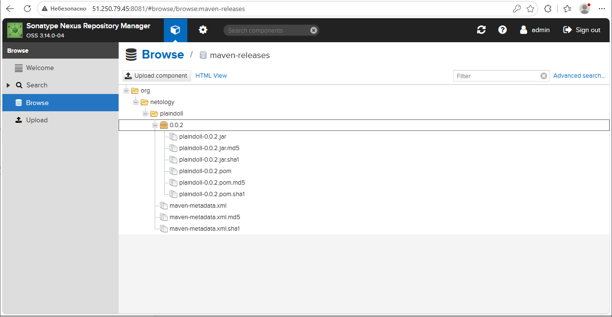

**6. Мигрируйте build configuration в репозиторий.**
*   В настройках проекта включена синхронизация с VCS (Versioned Settings). В качестве формата выбран Kotlin DSL. Настройки успешно сгенерированы и сохранены в директорию `.teamcity` в корне репозитория.

*Скриншот структуры репозитория:*

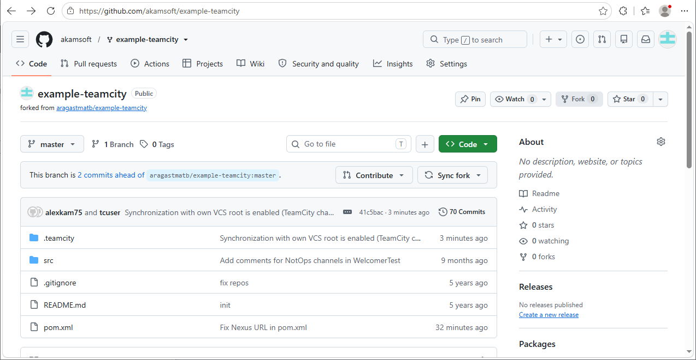

**7. Создайте отдельную ветку `feature/add_reply` в репозитории. Напишите новый метод для класса Welcomer: метод должен возвращать произвольную реплику, содержащую слово hunter. Дополните тест для нового метода на поиск слова hunter в новой реплике.**
*   В ветке `feature/add_reply` в класс `Welcomer` добавлен метод `reply()`, возвращающий строку `"Hello, hunter!"`. В `WelcomerTest` добавлен соответствующий тест `testReplyContainsHunter()`, проверяющий наличие подстроки `hunter` через `assertTrue`.

**8. Сделайте push всех изменений в новую ветку репозитория. Убедитесь, что сборка самостоятельно запустилась, тесты прошли успешно.**
*   Изменения запушены. TeamCity автоматически обнаружил новую ветку и запустил сборку `#7`. Так как ветка не `master`, выполнился шаг `mvn clean test`. Сборка зеленая, Tests passed: 6.

*Скриншот сборки ветки feature/add_reply:*

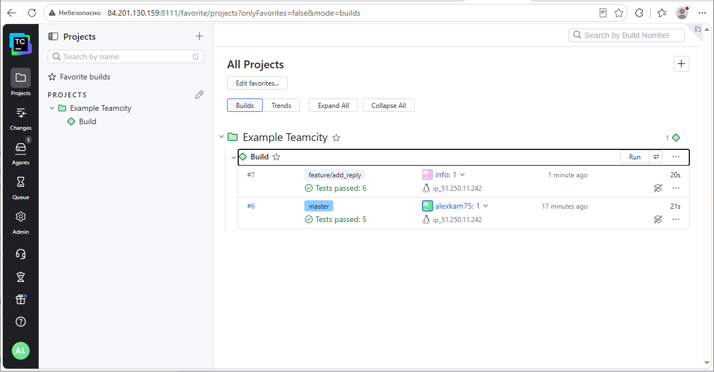

**9. Внесите изменения из произвольной ветки `feature/add_reply` в `master` через Merge. Убедитесь, что нет собранного артефакта в сборке по ветке `master`.**
*   Ветка слита в `master`. Автоматически запустилась сборка `#8`. Проверка вкладки `Artifacts` показала сообщение `No user-defined artifacts in this build`.

*Скриншот сборки без артефактов:*

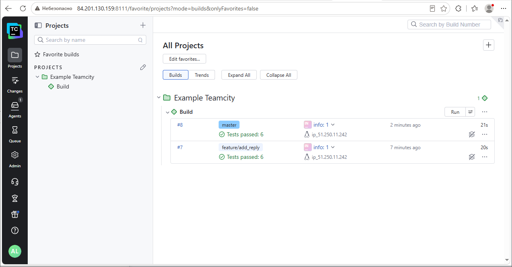

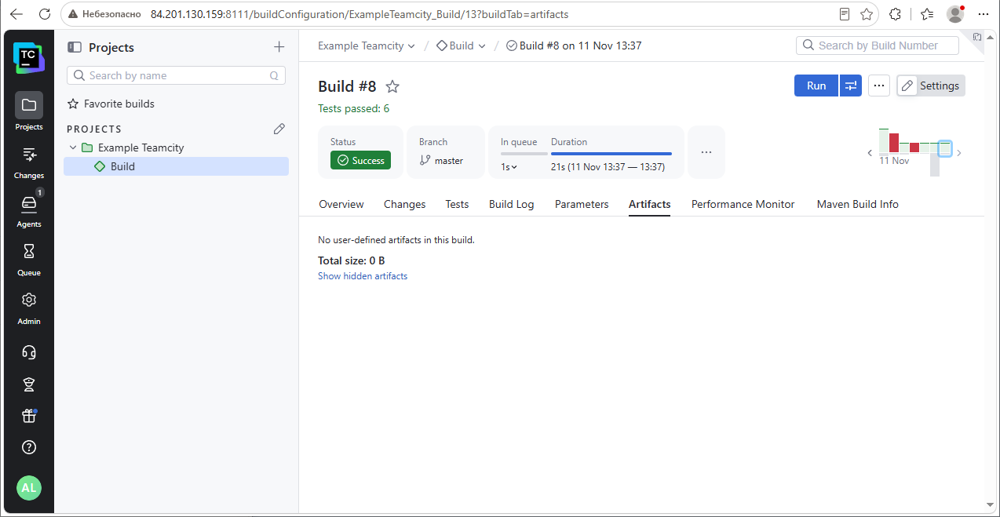

**10. Настройте конфигурацию так, чтобы она собирала `.jar` в артефакты сборки. Проведите повторную сборку мастера, убедитесь, что сбора прошла успешно и артефакты собраны.**
*   В настройках `General Settings` -> `Artifact Paths` добавлено правило `**/target/*.jar => *.jar`. Запущена повторная сборка `master` (`#9`). На вкладке `Artifacts` успешно появились собранные JAR-файлы (включая shaded-версию от плагина maven-shade).

*Скриншот сборки с артефактами:*

**11. Проверьте, что конфигурация в репозитории содержит все настройки конфигурации из teamcity.**
*   Проверено: все изменения, включая условия выполнения шагов (branch conditions) и настройки путей артефактов (artifact rules), были синхронизированы и закоммичены в файлы `.kts` в репозитории.

*Скриншот VCS Roots и настроек:*

---

## 💡 Комментарий к выполнению (Проблемы и их решения)
В ходе выполнения задания были выявлены и устранены следующие нетривиальные моменты:
1.  **Кавычки в `SERVER_URL`**: При настройке агента кавычки в переменной окружения приводили к невозможности подключения. Значение было исправлено на строго `http://<ip>:8111` без кавычек.
2.  **Ошибка `Permission denied` при Ansible**: В playbook была добавлена установка пакета `acl` и обновление `apt` кэша, так как ОС развернутой ВМ — Ubuntu, а не CentOS.
3.  **Ошибка `400 Bad Request` в Nexus**: При повторном деплое Nexus блокировал перезапись (политика `Disable redeploy`). Политика репозитория `maven-releases` была изменена на `Allow redeploy`.
4.  **Проблема с `generated_settings.zip` в TeamCity**: При включении Versioned Settings возникла известная ошибка с упаковкой артефактов. Для её решения в файл `teamcity-startup.properties` внутри контейнера сервера было добавлено свойство `teamcity.internal.artifacts.useZip64=false`.

---

### 📌 Как сдать задание:
1. Создайте репозиторий на GitHub.
2. Скопируйте этот текст в `README.md`.
3. Загрузите приложенные вами скриншоты в папку `screenshots` в репозитории.
4. Убедитесь, что ссылки на картинки в README совпадают с названиями файлов.
5. Ссылку на ваш **новый репозиторий** (где лежит этот `README.md` и папка со скриншотами) прикрепите в качестве ответа в личном кабинете Нетологии.
